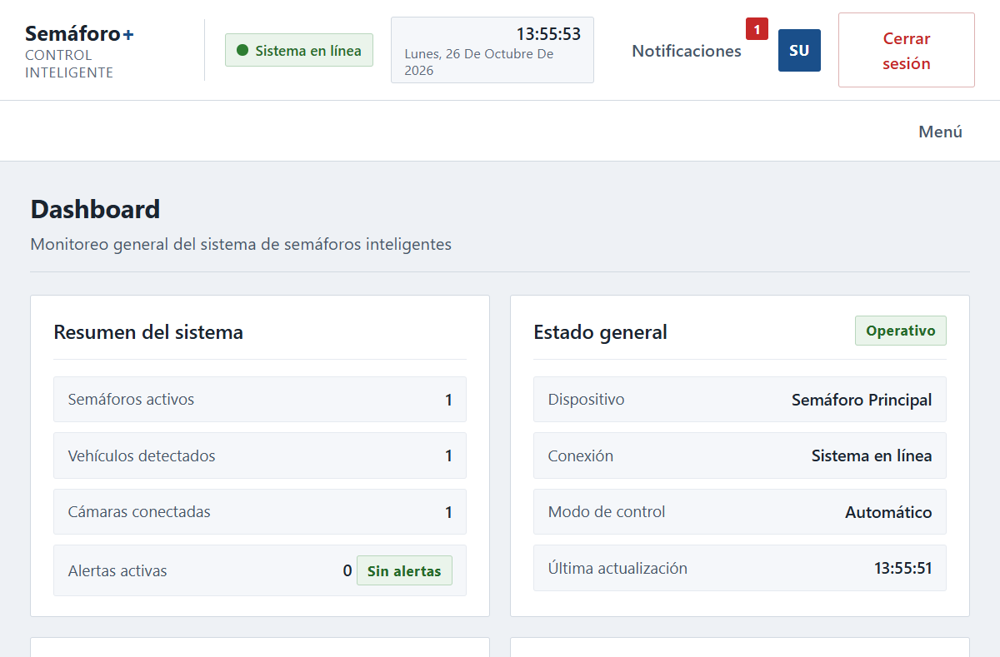
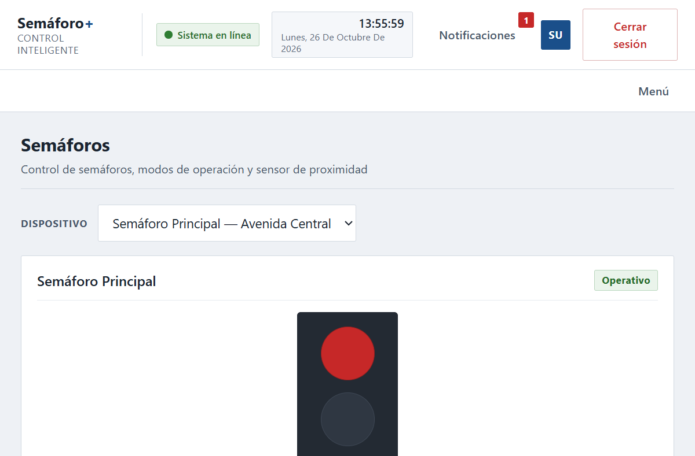
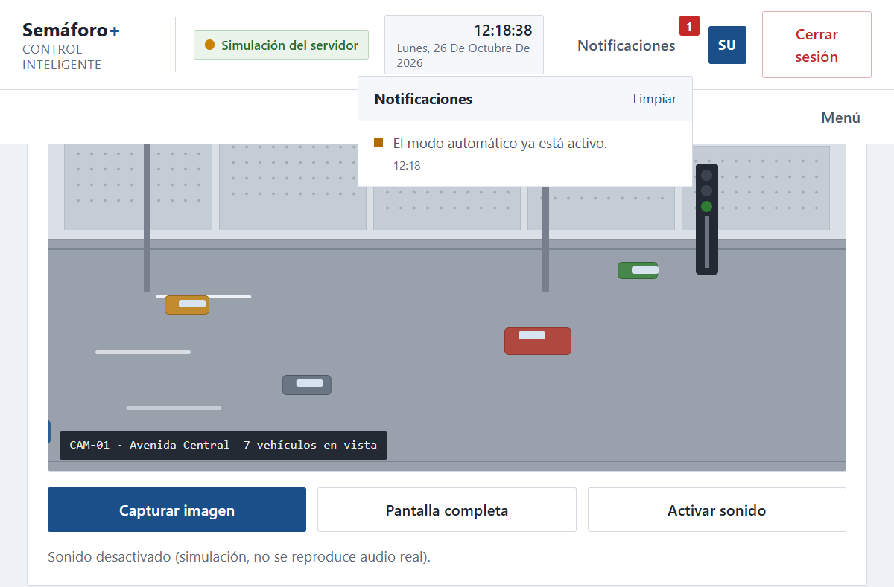
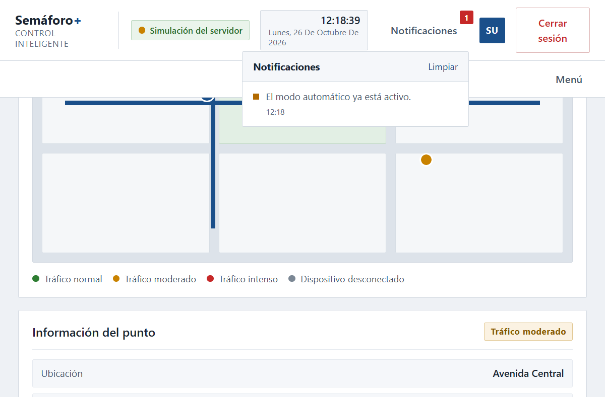
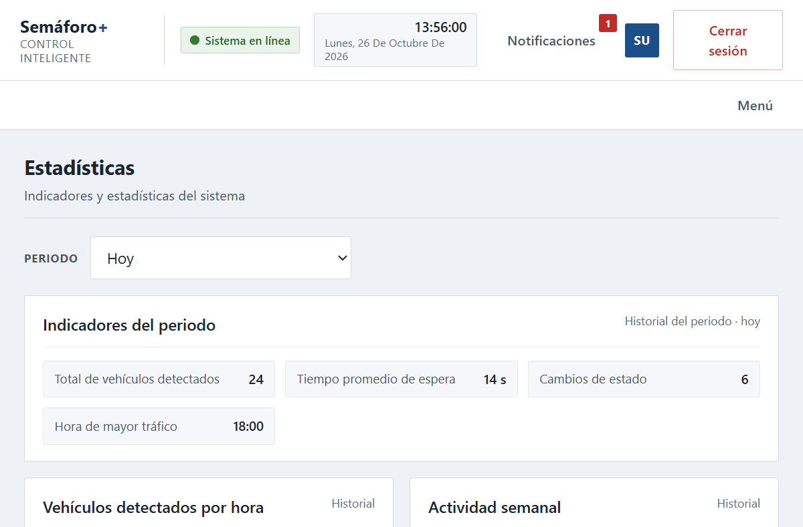
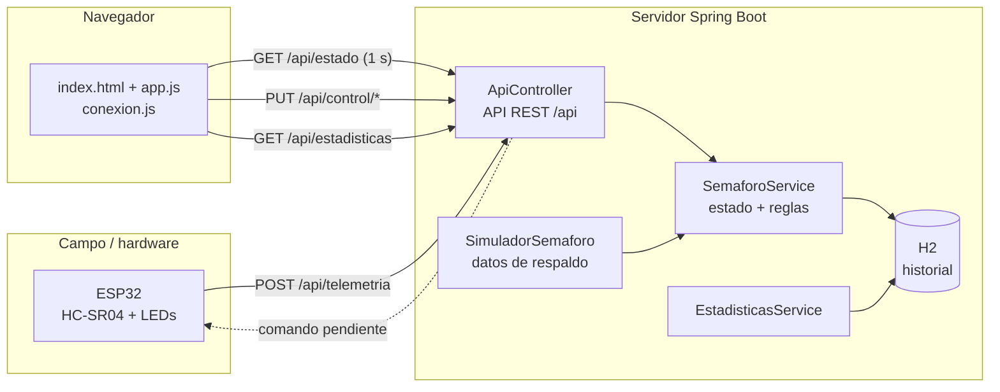

# 🚦 Semáforo+

Sistema inteligente de monitoreo y control de semáforos. La interfaz web muestra
en tiempo real la distancia medida por un sensor **HC-SR04**, el estado del
semáforo y las estadísticas de tráfico. Un **ESP32** envía la telemetría a un
backend **Spring Boot** con base de datos **H2**.


[](https://github.com/RuthSurco/semaforo-/actions/workflows/build.yml)

---

## 📸 Vista rápida

| Dashboard | Semáforos |
|---|---|
|  |  |

| Cámara | Mapa y rutas |
|---|---|
|  |  |



> Las capturas son de la simulación integrada. Cuando conectes el ESP32, el
> indicador cambiará a **ESP32 conectado**.

---

## ✨ Características

- 📊 **Panel en tiempo real** con distancia, detección de vehículo, color y modo.
- 🚥 **Control automático y manual** del semáforo desde la web.
- 📡 **API REST** para que el ESP32 envíe telemetría y reciba comandos.
- 🧠 **Control adaptativo**: en automático, el color responde a la presencia de vehículos.
- 🗄️ **Historial persistente** en H2 y estadísticas calculadas desde datos reales.
- 🔁 **Simulador de respaldo** cuando no hay hardware conectado.
- 🕹️ **Botones de simulación** para demostrar sin ESP32.
- 📱 **Interfaz responsive** (HTML5 + CSS3 + JavaScript puro, sin frameworks).
- 🛡️ **Manejo global de errores** y validación de datos en la API.
- 🐳 Repositorio listo para trabajar en equipo con ramas y Pull Requests.

---

## 🧱 Arquitectura



**Estilo:** cliente-servidor + monolito Spring Boot en capas
`Controller → Service → Repository → Entity`, con DTOs para la API.

📖 Más detalle en [docs/ARQUITECTURA.md](docs/ARQUITECTURA.md).

---

## 🛠 Tecnologías

| Capa | Tecnología |
|---|---|
| Backend | Java 21, Spring Boot 3.5.6, Spring Web, Spring Data JPA |
| Base de datos | H2 (en memoria) |
| Frontend | HTML5, CSS3, JavaScript puro (sin frameworks) |
| Hardware | ESP32, sensor ultrasónico HC-SR04, 3 LEDs |
| Build | Maven 3.9+ |
| CI | GitHub Actions |

---

## 🚀 Inicio rápido

### Requisitos

- Java 21
- Maven 3.9+

### Ejecutar

**Opción 1 (Windows):** doble clic en `backend/iniciar.bat`.

**Opción 2 (consola):**

```powershell
cd backend
mvn spring-boot:run
```

Abre: **http://localhost:8080**

| Usuario | Contraseña |
|---|---|
| `superadmin` | `123456` |
| `admin` | `123456` |

> ⚠️ El login actual es **simulado en el navegador** (igual que el prototipo
> original). Migrarlo a Spring Security está en el roadmap.

### Consola de base de datos

- URL: http://localhost:8080/h2-console
- JDBC URL: `jdbc:h2:mem:semaforoplus`
- Usuario: `sa` — Contraseña: *(vacía)*

---

## 📁 Estructura del repositorio

```
.
├── backend/                      # Aplicación Spring Boot
│   ├── src/main/java/com/semaforoplus/
│   │   ├── modelo/               # Entidad Lectura
│   │   ├── repositorio/          # Spring Data JPA
│   │   ├── servicio/             # Reglas, simulador, estadísticas
│   │   └── web/                  # Controladores, DTOs, errores
│   ├── src/main/resources/
│   │   ├── application.yml
│   │   └── static/               # Interfaz web servida por Spring
│   ├── iniciar.bat
│   └── README.md
├── docs/
│   ├── ARQUITECTURA.md
│   ├── API.md
│   ├── CONEXION_ESP32.md
│   └── img/                      # Capturas para el README
├── firmware/
│   └── esp32_semaforo.ino        # Código base del ESP32
├── tools/
│   └── simulador_esp32.py        # Envía telemetría sin hardware
├── index.html                    # Prototipo original (referencia)
├── estilos.css
├── app.js
└── README.md
```

> La versión que se ejecuta y se debe editar está en
> `backend/src/main/resources/static/`. Los archivos de la raíz son el
> prototipo original, conservados como referencia.

---

## 🔌 API REST

| Método | Ruta | Descripción |
|---|---|---|
| GET | `/api/estado` | Estado actual del semáforo |
| POST | `/api/telemetria` | El ESP32 envía una lectura |
| GET | `/api/telemetria?distancia=30&vehiculo=1` | Alternativa por parámetros |
| PUT | `/api/control/modo` | Cambia a `automatico` o `manual` |
| PUT | `/api/control/color` | Cambia el color (solo en manual) |
| GET | `/api/control/pendiente` | Comando pendiente para el ESP32 |
| GET | `/api/historial?limite=50` | Últimas lecturas |
| GET | `/api/estadisticas?periodo=hoy` | Estadísticas del periodo |
| POST | `/api/simulacion/{accion}` | Simula `acercar`, `alejar`, `via-libre`, `restablecer` |
| GET | `/api/salud` | Estado del servidor |

📖 Contrato completo con ejemplos en [docs/API.md](docs/API.md).

---

## 📡 Conectar el ESP32

1. El ESP32 y la PC deben estar en la **misma red WiFi de 2.4 GHz**.
2. Averigua la IP de la PC con `ipconfig`.
3. Abre el puerto 8080 en el Firewall de Windows.
4. Ajusta `SERVIDOR` en `firmware/esp32_semaforo.ino` con esa IP.
5. Carga el sketch y abre la web: el indicador debe decir **ESP32 conectado**.

📖 Guía paso a paso, cableado y solución de problemas en
[docs/CONEXION_ESP32.md](docs/CONEXION_ESP32.md).

### Probar sin hardware

```powershell
python tools/simulador_esp32.py --servidor http://localhost:8080
```

---

## 👥 Trabajo en equipo

- `main`: versión estable que se presenta.
- `develop`: integración de cambios.
- `feature/nombre`: una rama por funcionalidad.
- Cada cambio entra por **Pull Request** y revisión de otro compañero.
- Para dar acceso: **Settings → Collaborators → Add people**.

Flujo básico:

```powershell
git checkout develop
git pull
git checkout -b feature/mi-cambio
# ... trabajar ...
git add .
git commit -m "feat: describe el cambio"
git push -u origin feature/mi-cambio
```

---

## 🗺 Roadmap

- [x] Backend Spring Boot con API REST.
- [x] Interfaz web conectada al backend.
- [x] Simulador de respaldo sin hardware.
- [x] Historial y estadísticas en H2.
- [x] Documentación, capturas y CI.
- [ ] Autenticación real con Spring Security (usuarios en BD).
- [ ] Mover usuarios y configuración de `localStorage` a la base de datos.
- [ ] Tiempo real con SSE o WebSocket (reemplazar el polling).
- [ ] Mapa real con Leaflet + OpenStreetMap.
- [ ] Cámara real ESP32-CAM (stream MJPEG).
- [ ] MariaDB + Flyway y despliegue con Docker.
- [ ] MQTT y soporte para varios semáforos.
- [ ] Módulo opcional de Machine Learning para predicción de tráfico.

---

## ⚠️ Limitaciones conocidas

- El **login es simulado** y los usuarios viven en el navegador.
- La **base de datos H2 es en memoria**: el historial se reinicia al apagar.
- La **cámara y el mapa son simulaciones** (no usan hardware ni APIs externas).
- La comunicación usa **polling cada segundo** (suficiente para la demo).
- La API **no tiene autenticación** todavía; úsala solo en una red de confianza.

---

## 📄 Créditos

Proyecto académico de un sistema de semáforo inteligente con **Spring Web + Java**.
Interfaz original en HTML/CSS/JavaScript, adaptada para consumir la API REST.
